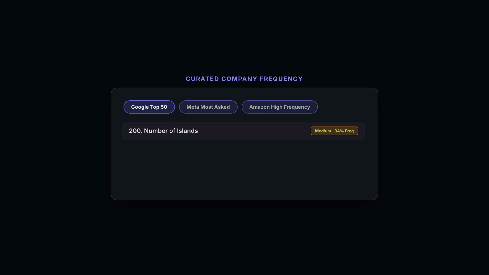

# PrepBuddy 🚀

> Focus your interview prep, fast.

PrepBuddy is an open-source dashboard for tracking company-prioritized LeetCode problems, monitoring your progress, surfacing difficulty trends, and benchmarking against peers—all from a single interface.

<p align="center">
  <video src="https://github.com/kiranpuli/prep-buddy/raw/master/public/prepbuddy-demo.mp4" poster="public/prepbuddy-demo.jpg" controls="controls" width="100%">
    <a href="https://github.com/kiranpuli/prep-buddy/raw/master/public/prepbuddy-demo.mp4">
      
    </a>
  </video>
</p>

<p align="center">
  <em>▶ <a href="https://github.com/kiranpuli/prep-buddy/raw/master/public/prepbuddy-demo.mp4">Watch the 18-second PrepBuddy Product Walkthrough</a></em>
</p>

## ✨ Features

- 🏢 **Company-Focused Collections** - Browse curated problem sets from top tech companies
- 📊 **Progress Tracking** - Track completed problems with Firebase sync across devices
- 📈 **Visual Analytics** - Difficulty breakdowns, frequency distributions, and topic intensity charts
- 🏆 **Live Leaderboard** - Compete with other PrepBuddy users in real-time
- 🔍 **Advanced Filtering** - Search by company, timeframe, difficulty, and topic
- 🎨 **Beautiful UI** - Glass-morphism inspired design with dark mode
- ⚡ **Performance Optimized** - Virtual scrolling for smooth handling of large datasets
- 🔐 **Google Authentication** - Secure sign-in with Firebase Auth

## 🤝 Contributing

We'd love your help making PrepBuddy the ultimate interview prep resource! Here's how you can contribute:

### What we're looking for:
- ✅ **New company problem sets** - Add questions from companies not yet covered
- ✅ **Additional questions** - Expand existing company datasets
- ✅ **Data corrections** - Fix errors in problem titles, links, or difficulty ratings
- ✅ **Bug fixes** - Help squash bugs you encounter

> 💡 **Note:** Feature development is currently paused while we focus on expanding our question database.

### How to contribute:

1. Fork the repository
2. Add your data following the format in [Adding New Company Data](#-adding-new-company-data)
3. Commit your changes (`git commit -m 'Add [Company] questions'`)
4. Push to your fork (`git push origin main`)
5. Open a Pull Request

Every contribution helps thousands of developers prepare for their dream jobs at top tech companies!

## 🚀 Quick Start

### Prerequisites

- Node.js 18+ and npm
- Firebase project (for authentication and Firestore)

### Installation

1. **Clone the repository**
   ```bash
   git clone https://github.com/kiranpuli/prepbuddy.git
   cd prepbuddy
   ```

2. **Install dependencies**
   ```bash
   npm install
   ```

3. **Configure Firebase**
   
   Create `src/config/firebase.ts` with your Firebase credentials:
   ```typescript
   import { initializeApp } from 'firebase/app';
   import { getAnalytics, isSupported, type Analytics } from 'firebase/analytics';
   import {
     browserLocalPersistence,
     getAuth,
     GoogleAuthProvider,
     setPersistence,
     type Auth,
   } from 'firebase/auth';
   import { getFirestore, type Firestore } from 'firebase/firestore';

   const firebaseConfig = {
     apiKey: 'YOUR_API_KEY',
     authDomain: 'YOUR_AUTH_DOMAIN',
     projectId: 'YOUR_PROJECT_ID',
     storageBucket: 'YOUR_STORAGE_BUCKET',
     messagingSenderId: 'YOUR_MESSAGING_SENDER_ID',
     appId: 'YOUR_APP_ID',
     measurementId: 'YOUR_MEASUREMENT_ID',
   };

   const app = initializeApp(firebaseConfig);

   let analytics: Analytics | undefined;

   if (typeof window !== 'undefined') {
     void isSupported().then((supported) => {
       if (supported) {
         analytics = getAnalytics(app);
       }
     });
   }

   const auth: Auth = getAuth(app);
   const googleProvider = new GoogleAuthProvider();

   void setPersistence(auth, browserLocalPersistence).catch(() => {
     // Fallback to default persistence
   });

   const db: Firestore = getFirestore(app);

   export { app, analytics, auth, googleProvider, db };
   ```

4. **Set up Firestore security rules**
   
   Deploy the included `firestore.rules`:
   ```bash
   firebase deploy --only firestore:rules
   ```

5. **Start development server**
   ```bash
   npm run dev
   ```

6. **Build for production**
   ```bash
   npm run build
   ```

## 🗂️ Project Structure

```
prepbuddy/
├── data/                    # Company-wise problem CSV files
│   ├── Amazon/
│   ├── Google/
│   └── ...
├── src/
│   ├── components/          # React components
│   ├── pages/              # Page components
│   ├── store/              # Zustand state management
│   ├── services/           # Firebase & API services
│   ├── utils/              # Utility functions
│   └── config/             # Configuration files (gitignored)
├── firestore.rules         # Firestore security rules
├── firebase.json           # Firebase hosting config
└── package.json
```

## 🔧 Tech Stack

- **Frontend**: React 18, TypeScript, Vite
- **Styling**: Tailwind CSS
- **State Management**: Zustand
- **Data Visualization**: Recharts
- **Authentication**: Firebase Auth
- **Database**: Cloud Firestore
- **Hosting**: Firebase Hosting
- **Virtualization**: TanStack React Virtual
- **CSV Parsing**: PapaParse

## 📝 Adding New Company Data

To add problems for a new company:

1. Create a folder under `data/` with the company name
2. Add CSV files following the naming convention: `1. Thirty Days.csv`, `2. Three Months.csv`, etc.
3. Ensure CSV has columns: `Title`, `Difficulty`, `Frequency`, `Acceptance Rate`, `Link`, `Topics`
4. The data will be automatically loaded by the app

## 🔐 Environment Variables

For GitHub Actions deployment, set these secrets in your repository:

- `FIREBASE_SERVICE_ACCOUNT`: Firebase service account JSON
- `VITE_FIREBASE_API_KEY`: Firebase API key
- `VITE_FIREBASE_AUTH_DOMAIN`: Firebase auth domain
- `VITE_FIREBASE_PROJECT_ID`: Firebase project ID
- `VITE_FIREBASE_STORAGE_BUCKET`: Firebase storage bucket
- `VITE_FIREBASE_MESSAGING_SENDER_ID`: Firebase messaging sender ID
- `VITE_FIREBASE_APP_ID`: Firebase app ID
- `VITE_FIREBASE_MEASUREMENT_ID`: Firebase measurement ID

## 📄 License

This project is licensed under the MIT License - see the [LICENSE](LICENSE) file for details.

## 🙏 Acknowledgments

- LeetCode for providing the platform that inspired this tool
- All contributors who help make PrepBuddy better

## 📧 Contact

For questions, feedback, or support, please [open an issue](https://github.com/kiranpuli/prep-buddy/issues) on GitHub.

---

**PrepBuddy** - Made with ❤️ for the coding interview prep community
